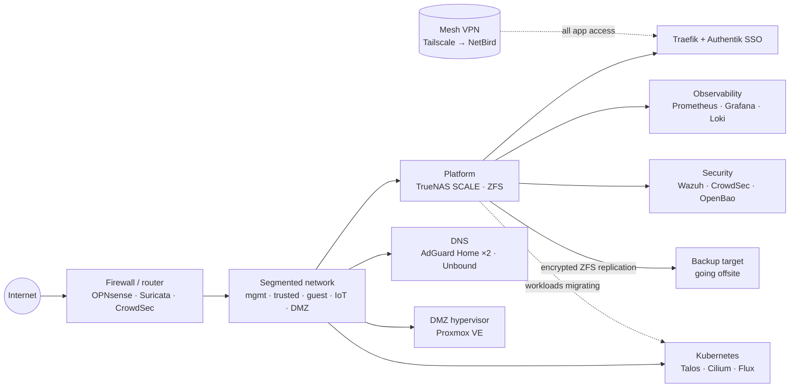

 

## 👋 Hi

I build and run infrastructure for a living, and then go home and do it again for fun. Most of my
recent work lives in a self-hosted Forgejo, so this profile is the public window into it: how the
lab is put together, what it runs, and the bits of code that make it out into the open.

- 🔭 **Now:** running a Talos Kubernetes cluster with Flux GitOps and moving more and more workloads onto it, plus getting secrets into OpenBao
- 🔐 **Care about:** least privilege, encrypted backups that are actually restore-tested, boring reliability
- 🎛️ **Also:** retro audio. C64 SID chips, MIDI and hardware synths

## 🏠 The homelab

This is a learning environment first. A firewall splits the network into isolated segments, the DMZ
can't reach anything, and no app is exposed to the internet: everything is reached over a mesh VPN.

Right now one platform box carries storage, apps, identity and observability. That makes it a single
point of failure, and it is there because of budget, not because it is the design I would choose.
The Kubernetes cluster is the way out of it: new services land there, and existing ones move over
bit by bit.

| Layer | What runs there |
|---|---|
| **Edge** | OPNsense, VLAN segmentation, hard-walled DMZ, Suricata IDS, CrowdSec bouncers |
| **Remote access** | Mesh VPN only (Tailscale, moving to self-hosted NetBird). No apps published to the internet |
| **Platform** | TrueNAS SCALE, ZFS (RAIDZ2 + SSD mirror, native encryption), Docker Compose apps kept in Git |
| **Ingress and identity** | Traefik, Authentik (SSO / OIDC in front of everything), Vaultwarden |
| **Observability** | Prometheus, Alertmanager, Grafana, Loki + Alloy, Uptime Kuma, ntfy |
| **Security** | CrowdSec, Suricata, Wazuh, OpenBao 🚧, UPS-managed graceful shutdown with NUT |
| **Virtualisation** | Proxmox VE for isolated DMZ workloads |
| **Kubernetes** | Talos Linux, Cilium, Flux, cert-manager, External Secrets, Renovate, Trivy. In use, with more services still to move over from the platform box |
| **Backups** | ZFS snapshots, raw encrypted replication to a second machine, 3-2-1 with an offsite copy |
| **Self-hosted** | Forgejo, Nextcloud, Immich, Jellyfin, Navidrome, BookStack, Home Assistant 📋 |
| **Local AI** | Ollama, LiteLLM gateway, a GPU workstation for inference |

🚧 in progress · 📋 planned

## 🧰 Toolbox

## 📦 Projects

| Project | What it is |
|---|---|
| [sidplay4-asidmod](https://github.com/mselin/sidplay4-asidmod) | SIDPLAY with ASID output, for playing C64 SID tunes on real SID hardware over MIDI |
| [machine-learning-udacity](https://github.com/mselin/machine-learning-udacity) | Coursework and notebooks from Udacity's machine learning programme |
| Homelab infrastructure | Compose stacks, GitOps manifests and runbooks. Lives in self-hosted Forgejo; public pieces are on their way to [Codeberg](https://codeberg.org/mselin) |

<picture>
  <source media="(prefers-color-scheme: dark)" srcset="https://raw.githubusercontent.com/mselin/mselin/output/snake-dark.svg">
  
</picture>

