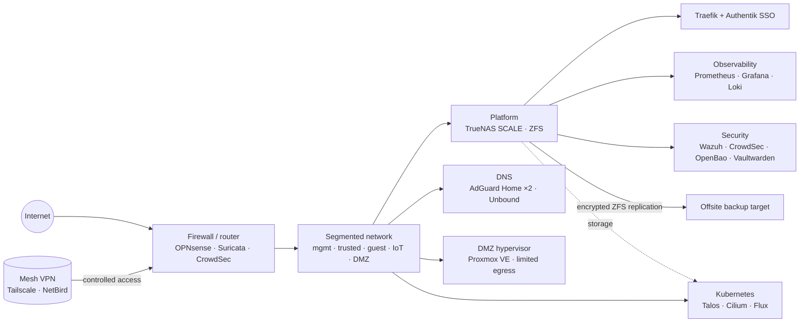

 

## 👋 Hi

I do full-stack and DevOps work for a living and run a homelab on the side. Most of my code sits in
a self-hosted Forgejo, so there isn't much to see here. This page describes the lab instead.

- 🔭 **Running:** Talos Kubernetes with Flux, a TrueNAS box for storage and apps, OpenBao for secrets
- 🤖 **AI stack:** llama-swap and Ollama behind LiteLLM, plus AnythingLLM and Strata. Sandboxed, with limited egress and improved observability. BMAD and Spec Kit run in a hardened Dev Container
- 🔐 **I care about:** least privilege, backups that get restore-tested, and a lab that keeps working without internet
- 🎮 **Also:** Linux gaming and C64 SID music

## 🏠 The homelab

The lab is for learning. The network is split into VLANs behind OPNsense, and the DMZ can't reach
the rest of it. No app is exposed to the internet; I get to everything over a mesh VPN. Outbound
traffic from the DMZ and the AI stack is limited to an allow-list.

Storage, apps, identity and monitoring all run on one box. That is a single point of failure, and
I'd build it differently with a bigger budget. There is also a Kubernetes cluster.

Things change here all the time, so this page shows how the lab is built, not what state it is in
today.

| Layer | What runs there |
|---|---|
| **Edge** | [OPNsense](https://github.com/opnsense/core), VLAN segmentation, isolated DMZ with limited egress, [Suricata](https://github.com/OISF/suricata) IDS, [CrowdSec](https://github.com/crowdsecurity/crowdsec) bouncers, Ubiquiti UniFi Wi-Fi managed from the UniFi Network controller |
| **Remote access** | [WireGuard](https://github.com/WireGuard/wireguard-tools)-based mesh VPN only ([Tailscale](https://github.com/tailscale/tailscale) and self-hosted [NetBird](https://github.com/netbirdio/netbird)). No apps published to the internet |
| **Platform** | [TrueNAS SCALE](https://github.com/truenas), Docker Compose apps kept in Git |
| **Storage** | [TrueNAS](https://github.com/truenas) on [ZFS](https://github.com/openzfs/zfs): RAIDZ pools, native encryption on every dataset, snapshots |
| **Ingress and identity** | [Traefik](https://github.com/traefik/traefik), [Authentik](https://github.com/goauthentik/authentik) (SSO / OIDC for every app), [nginx](https://github.com/nginx/nginx) when it needs to be fast |
| **Observability** | [Prometheus](https://github.com/prometheus/prometheus), [Alertmanager](https://github.com/prometheus/alertmanager), [Grafana](https://github.com/grafana/grafana), [Loki](https://github.com/grafana/loki) + [Alloy](https://github.com/grafana/alloy), [Uptime Kuma](https://github.com/louislam/uptime-kuma), [ntfy](https://github.com/binwiederhier/ntfy) |
| **Security** | [CrowdSec](https://github.com/crowdsecurity/crowdsec) with [crowdsec-blocklist-import](https://github.com/wolffcatskyy/crowdsec-blocklist-import) for extra blocklists, [Suricata](https://github.com/OISF/suricata), [Wazuh](https://github.com/wazuh/wazuh), [Vaultwarden](https://github.com/dani-garcia/vaultwarden), [OpenBao](https://github.com/openbao/openbao), UPS monitored and controlled by [NUT](https://github.com/networkupstools/nut) (upsd) with graceful shutdown |
| **Virtualisation** | Proxmox VE for isolated DMZ workloads with limited egress |
| **Kubernetes** | [Talos](https://github.com/siderolabs/talos) Linux, [Cilium](https://github.com/cilium/cilium), [Flux](https://github.com/fluxcd/flux2), [cert-manager](https://github.com/cert-manager/cert-manager), [External Secrets](https://github.com/external-secrets/external-secrets), [Renovate](https://github.com/renovatebot/renovate), [Trivy](https://github.com/aquasecurity/trivy) |
| **Backups** | [ZFS](https://github.com/openzfs/zfs) snapshots, raw encrypted replication to a second machine, 3-2-1 with an offsite copy |
| **Containers and dev environments** | [Docker](https://github.com/moby/moby), [Podman](https://github.com/containers/podman), [Dev Containers](https://github.com/devcontainers/spec) for sandboxed project environments |
| **Offline resilience** | Should keep working through a long internet outage. Important upstream repos are mirrored in Forgejo, and Wikipedia, iFixit and other wikis are available offline through [Kiwix](https://github.com/kiwix/kiwix-tools) |
| **Languages and frameworks** | [Python](https://github.com/python/cpython), [TypeScript](https://github.com/microsoft/TypeScript), [Go](https://github.com/golang/go), [C#](https://github.com/dotnet/csharplang), Bash, [Node.js](https://github.com/nodejs/node), [React](https://github.com/facebook/react) |
| **Daily drivers** | [Linux](https://git.kernel.org/pub/scm/linux/kernel/git/torvalds/linux.git) mostly: [CachyOS](https://cachyos.org) on the desktop for work and gaming, macOS on the laptop, NixOS, and Windows less and less |
| **Shell and dotfiles** | [zsh](https://github.com/zsh-users/zsh) with [Oh My Zsh](https://github.com/ohmyzsh/ohmyzsh), [tmux](https://github.com/tmux/tmux) with [tpm](https://github.com/tmux-plugins/tpm) plugins such as [continuum](https://github.com/tmux-plugins/tmux-continuum) and [resurrect](https://github.com/tmux-plugins/tmux-resurrect) for sessions that survive reboots, [chezmoi](https://github.com/twpayne/chezmoi) to keep dotfiles in sync across machines |

### App stack

Every app is behind SSO and defined as a Compose file in Git. The groups below match my Homepage
dashboard.

| Group | Apps |
|---|---|
| **AI** | [llama-swap](https://github.com/mostlygeek/llama-swap), [Ollama](https://github.com/ollama/ollama), [LiteLLM](https://github.com/BerriAI/litellm) gateway, [AnythingLLM](https://github.com/Mintplex-Labs/anything-llm), [Strata](https://github.com/Niko1221/Strata). Sandboxed, with limited egress and improved observability. [BMAD](https://github.com/bmad-code-org/BMAD-METHOD) and [Spec Kit](https://github.com/github/spec-kit) run in a hardened [Dev Container](https://github.com/devcontainers/spec) |
| **Tools** | [Forgejo](https://codeberg.org/forgejo/forgejo), [Nextcloud](https://github.com/nextcloud/server), [BookStack](https://github.com/BookStackApp/BookStack), [Trilium Notes](https://github.com/TriliumNext/Trilium), [Joplin](https://github.com/laurent22/joplin), [Wallabag](https://github.com/wallabag/wallabag), [Karakeep](https://github.com/karakeep-app/karakeep), [Mealie](https://github.com/mealie-recipes/mealie), [Homebox](https://github.com/sysadminsmedia/homebox), [Draw.io](https://github.com/jgraph/drawio), [Code Server](https://github.com/coder/code-server), [JupyterLab](https://github.com/jupyterlab/jupyterlab), [pgAdmin](https://github.com/pgadmin-org/pgadmin4), [Syncthing](https://github.com/syncthing/syncthing), [Filebrowser](https://github.com/filebrowser/filebrowser), [Vaultwarden](https://github.com/dani-garcia/vaultwarden), [Speedtest Tracker](https://github.com/alexjustesen/speedtest-tracker), [Open Speedtest](https://github.com/openspeedtest/Speed-Test), [Domain Watchdog](https://github.com/maelgangloff/domain-watchdog) |
| **Media** | [Jellyfin](https://github.com/jellyfin/jellyfin), [Jellystat](https://github.com/CyferShepard/Jellystat), [Navidrome](https://github.com/navidrome/navidrome), [Lyrion](https://github.com/LMS-Community/slimserver), [Audiobookshelf](https://github.com/advplyr/audiobookshelf), [Kavita](https://github.com/Kareadita/Kavita), [Immich](https://github.com/immich-app/immich), [Tdarr](https://github.com/HaveAGitGat/Tdarr), [MeTube](https://github.com/alexta69/metube), [Automatic Ripping Machine](https://github.com/automatic-ripping-machine/automatic-ripping-machine) (ARM) |
| **Monitoring** | [Prometheus](https://github.com/prometheus/prometheus), [Alertmanager](https://github.com/prometheus/alertmanager), [Grafana](https://github.com/grafana/grafana), [Uptime Kuma](https://github.com/louislam/uptime-kuma), [ntfy](https://github.com/binwiederhier/ntfy), [Wazuh](https://github.com/wazuh/wazuh), [CrowdSec](https://github.com/crowdsecurity/crowdsec), [Portainer](https://github.com/portainer/portainer), [Traefik](https://github.com/traefik/traefik), [Authentik](https://github.com/goauthentik/authentik), [AdGuard Home](https://github.com/AdguardTeam/AdGuardHome) ×2, UniFi Network controller, NUT, plus OPNsense, TrueNAS and Proxmox dashboards |
| **Messaging** | [ntfy](https://github.com/binwiederhier/ntfy) for push notifications and alerts, Matrix on [Conduit](https://gitlab.com/famedly/conduit) for self-hosted chat |
| **Home automation** | [Home Assistant](https://github.com/home-assistant/core), [Frigate](https://github.com/blakeblackshear/frigate) NVR with local object detection |

## 🧰 Toolbox

## 📦 Projects

| Project | What it is |
|---|---|
| Homelab infrastructure | Compose stacks, Flux manifests and runbooks. Kept in my own Forgejo |
| Miscellaneous | TBA |

## 🎵 Music

Mostly SID, the sound chip in the Commodore 64.

| | |
|---|---|
| **Legacy 8-bit hardware** | Commodore 64 and Commodore 128D |
| **SID** | MOS 8580 in the Commodores, 6581 in the sammichSID |
| **sammichSID** | MIDIbox SID synth with real 6581 chips, played over MIDI |

<picture>
  <source media="(prefers-color-scheme: light)" srcset="https://raw.githubusercontent.com/mselin/mselin/output/snake.svg">
  
</picture>

