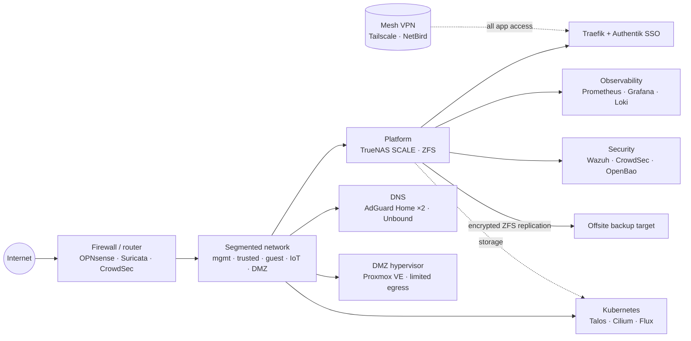

 

## 👋 Hi

I build software and run the infrastructure under it for a living, full stack and DevOps, and then go
home and do it again for fun. Most of my
recent work lives in a self-hosted Forgejo, so this profile is the public window into it: how the
lab is put together, what it runs, and the bits of code that make it out into the open.

- 🔭 **Running:** a Talos Kubernetes cluster with Flux GitOps next to a ZFS-backed app platform, with secrets in OpenBao
- 🤖 **AI stack:** local models on llama-swap and Ollama behind LiteLLM, with AnythingLLM and Strata, with improved observability, sandboxing and limited egress. Spec-driven agent work with BMAD and Spec Kit inside a hardened Dev Container
- 🔐 **Care about:** least privilege, encrypted backups that are actually restore-tested, boring reliability, and a lab that still works when the internet doesn't
- 🎮 **Also:** Linux gaming, and retro audio: C64 SID chips, MIDI and hardware synths

## 🏠 The homelab

This is a learning environment first. A firewall splits the network into isolated segments, the DMZ
can't reach anything, and no app is exposed to the internet: everything is reached over a mesh VPN. Outbound traffic is
restricted too, with limited egress for both the DMZ and the AI stack.

One platform box carries storage, apps, identity and observability. That makes it a single point of
failure, and it is there because of budget, not because it is the design I would choose. A Kubernetes
cluster runs alongside it.

Like any homelab, it is always in a state of flux. Read this page as a sketch of how things are
built, not as a status report.

| Layer | What runs there |
|---|---|
| **Edge** | [OPNsense](https://github.com/opnsense/core), VLAN segmentation, hard-walled DMZ with limited egress, [Suricata](https://github.com/OISF/suricata) IDS, [CrowdSec](https://github.com/crowdsecurity/crowdsec) bouncers, Ubiquiti UniFi Wi-Fi managed from the UniFi Network controller |
| **Remote access** | Mesh VPN only ([Tailscale](https://github.com/tailscale/tailscale) and self-hosted [NetBird](https://github.com/netbirdio/netbird)). No apps published to the internet |
| **Platform** | [TrueNAS SCALE](https://github.com/truenas/middleware), ZFS (RAIDZ2 + SSD mirror, native encryption), Docker Compose apps kept in Git |
| **Ingress and identity** | [Traefik](https://github.com/traefik/traefik), [Authentik](https://github.com/goauthentik/authentik) (SSO / OIDC in front of everything) |
| **Observability** | [Prometheus](https://github.com/prometheus/prometheus), [Alertmanager](https://github.com/prometheus/alertmanager), [Grafana](https://github.com/grafana/grafana), [Loki](https://github.com/grafana/loki) + [Alloy](https://github.com/grafana/alloy), [Uptime Kuma](https://github.com/louislam/uptime-kuma), [ntfy](https://github.com/binwiederhier/ntfy) |
| **Security** | [CrowdSec](https://github.com/crowdsecurity/crowdsec) with [crowdsec-blocklist-import](https://github.com/wolffcatskyy/crowdsec-blocklist-import) for extra blocklists, [Suricata](https://github.com/OISF/suricata), [Wazuh](https://github.com/wazuh/wazuh), [Vaultwarden](https://github.com/dani-garcia/vaultwarden), [OpenBao](https://github.com/openbao/openbao), UPS monitored and controlled by [NUT](https://github.com/networkupstools/nut) (upsd) with graceful shutdown |
| **Virtualisation** | Proxmox VE for isolated DMZ workloads with limited egress |
| **Kubernetes** | [Talos](https://github.com/siderolabs/talos) Linux, [Cilium](https://github.com/cilium/cilium), [Flux](https://github.com/fluxcd/flux2), [cert-manager](https://github.com/cert-manager/cert-manager), [External Secrets](https://github.com/external-secrets/external-secrets), [Renovate](https://github.com/renovatebot/renovate), [Trivy](https://github.com/aquasecurity/trivy) |
| **Backups** | ZFS snapshots, raw encrypted replication to a second machine, 3-2-1 with an offsite copy |
| **Containers and dev environments** | [Docker](https://github.com/moby/moby), [Podman](https://github.com/containers/podman), [Dev Containers](https://github.com/devcontainers/spec) for reproducible, sandboxed project environments |
| **Offline resilience** | Built to keep working through a long internet outage: local mirrors of the important upstream repos in Forgejo, and offline copies of reference wikis such as Wikipedia and iFixit |
| **Languages** | [Python](https://github.com/python/cpython), [TypeScript](https://github.com/microsoft/TypeScript), [Go](https://github.com/golang/go), [C#](https://github.com/dotnet/csharplang), Bash |
| **Daily drivers** | CachyOS on the desktop for work and Linux gaming, macOS on the laptop, NixOS, and Windows, though less and less these days |
| **Shell and dotfiles** | [zsh](https://github.com/zsh-users/zsh) with [Oh My Zsh](https://github.com/ohmyzsh/ohmyzsh), [tmux](https://github.com/tmux/tmux) with [tpm](https://github.com/tmux-plugins/tpm) plugins such as [continuum](https://github.com/tmux-plugins/tmux-continuum) and [resurrect](https://github.com/tmux-plugins/tmux-resurrect) for sessions that survive reboots, [chezmoi](https://github.com/twpayne/chezmoi) to keep dotfiles in sync across machines |

### App stack

Everything sits behind SSO, is kept as Compose files in Git, and is grouped on a Homepage dashboard
the same way as here. Each name links to the project behind it.

| Group | Apps |
|---|---|
| **AI** | [llama-swap](https://github.com/mostlygeek/llama-swap), [Ollama](https://github.com/ollama/ollama), [LiteLLM](https://github.com/BerriAI/litellm) gateway, [AnythingLLM](https://github.com/Mintplex-Labs/anything-llm), [Strata](https://github.com/Niko1221/Strata). Built with improved observability, sandboxing and limited egress. Spec-driven development with [BMAD](https://github.com/bmad-code-org/BMAD-METHOD) and [Spec Kit](https://github.com/github/spec-kit), run inside a hardened [Dev Container](https://github.com/devcontainers/spec) |
| **Tools** | [Forgejo](https://codeberg.org/forgejo/forgejo), [Nextcloud](https://github.com/nextcloud/server), [BookStack](https://github.com/BookStackApp/BookStack), [Trilium Notes](https://github.com/TriliumNext/Trilium), [Joplin](https://github.com/laurent22/joplin), [Wallabag](https://github.com/wallabag/wallabag), [Karakeep](https://github.com/karakeep-app/karakeep), [Mealie](https://github.com/mealie-recipes/mealie), [Homebox](https://github.com/sysadminsmedia/homebox), [Draw.io](https://github.com/jgraph/drawio), [Code Server](https://github.com/coder/code-server), [JupyterLab](https://github.com/jupyterlab/jupyterlab), [pgAdmin](https://github.com/pgadmin-org/pgadmin4), [Syncthing](https://github.com/syncthing/syncthing), [Filebrowser](https://github.com/filebrowser/filebrowser), [Vaultwarden](https://github.com/dani-garcia/vaultwarden), [Speedtest Tracker](https://github.com/alexjustesen/speedtest-tracker), [Open Speedtest](https://github.com/openspeedtest/Speed-Test), [Domain Watchdog](https://github.com/maelgangloff/domain-watchdog) |
| **Media** | [Jellyfin](https://github.com/jellyfin/jellyfin), [Jellystat](https://github.com/CyferShepard/Jellystat), [Navidrome](https://github.com/navidrome/navidrome), [Lyrion](https://github.com/LMS-Community/slimserver), [Audiobookshelf](https://github.com/advplyr/audiobookshelf), [Kavita](https://github.com/Kareadita/Kavita), [Immich](https://github.com/immich-app/immich), [Tdarr](https://github.com/HaveAGitGat/Tdarr), [MeTube](https://github.com/alexta69/metube) |
| **Monitoring** | [Prometheus](https://github.com/prometheus/prometheus), [Alertmanager](https://github.com/prometheus/alertmanager), [Grafana](https://github.com/grafana/grafana), [Uptime Kuma](https://github.com/louislam/uptime-kuma), [ntfy](https://github.com/binwiederhier/ntfy), [Wazuh](https://github.com/wazuh/wazuh), [CrowdSec](https://github.com/crowdsecurity/crowdsec), [Portainer](https://github.com/portainer/portainer), [Traefik](https://github.com/traefik/traefik), [Authentik](https://github.com/goauthentik/authentik), [AdGuard Home](https://github.com/AdguardTeam/AdGuardHome) ×2, UniFi Network controller, NUT, plus OPNsense, TrueNAS and Proxmox dashboards |
| **Messaging** | [ntfy](https://github.com/binwiederhier/ntfy) for push notifications and alerts, Matrix on [Conduit](https://gitlab.com/famedly/conduit) for self-hosted chat |
| **Home automation** | [Home Assistant](https://github.com/home-assistant/core), [Frigate](https://github.com/blakeblackshear/frigate) NVR with local object detection |

## 🧰 Toolbox

## 📦 Projects

| Project | What it is |
|---|---|
| Homelab infrastructure | Compose stacks, GitOps manifests and runbooks. Lives in self-hosted Forgejo |

<picture>
  <source media="(prefers-color-scheme: dark)" srcset="https://raw.githubusercontent.com/mselin/mselin/output/snake-dark.svg">
  
</picture>

